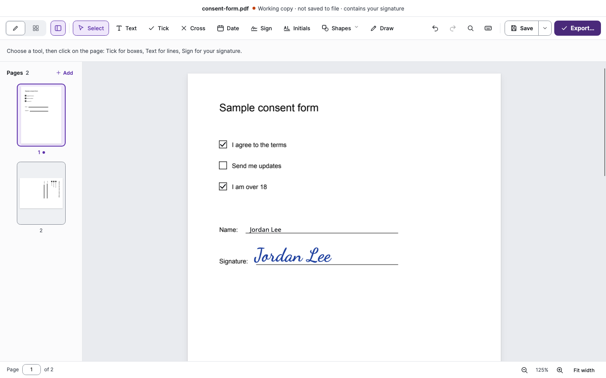
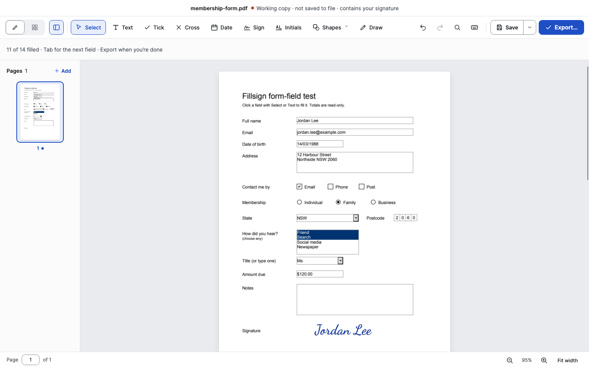
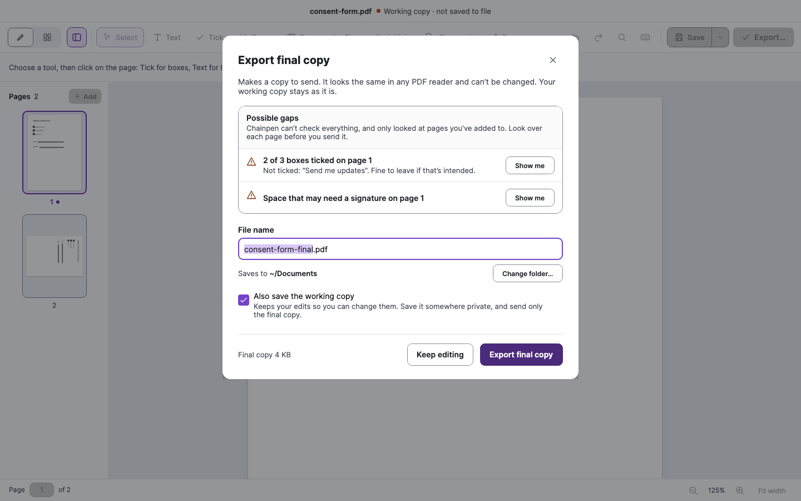
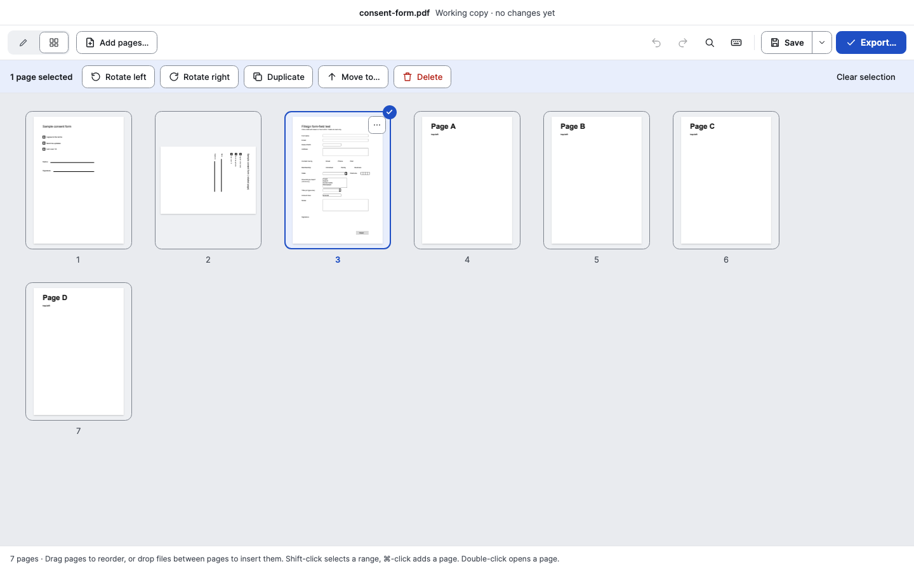
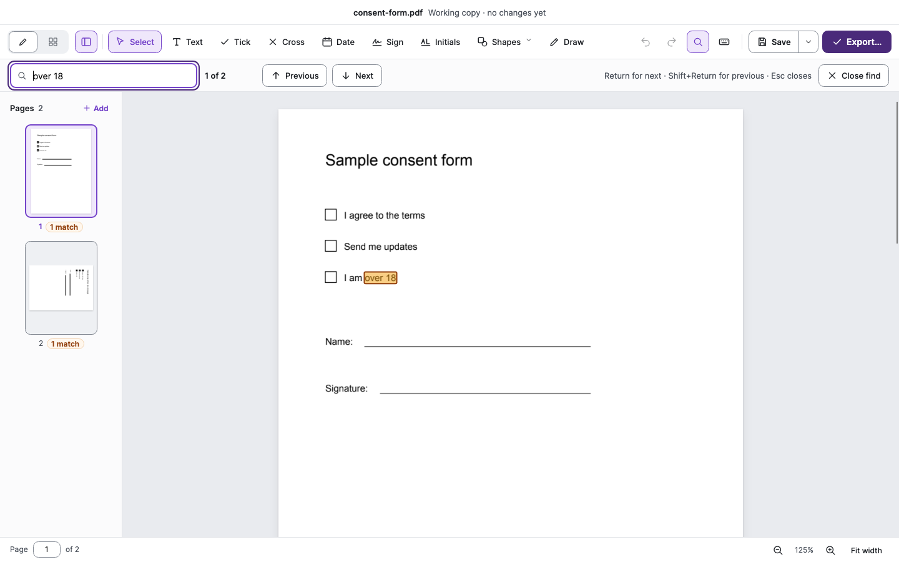

# Chainpen

Fill in and sign documents, especially scanned paper forms with no fillable fields. A native desktop app for Windows, macOS and Linux, built with .NET 11 and Avalonia.

> Status: beta. Bug reports and ideas are welcome in Issues; outside code contributions aren't accepted yet ([CONTRIBUTING](CONTRIBUTING.md)).

<!-- GitHub shows the dark screenshot to people browsing in dark mode, the light one otherwise. -->
<picture>
  <source media="(prefers-color-scheme: dark)" srcset="docs/images/scanned-form-dark.png">
  
</picture>

| | |
|---|---|
|  |  |
| Fill in a PDF's own form fields, and sign in its signature field. | Export a final copy to send. Chainpen points out what may still be missing. |
|  |  |
| Rotate, reorder, duplicate and delete pages, and add pages from other files. | Find words on the pages and in what you've added (⌘F / Ctrl+F). |

## Docs

- [User guide](docs/USER-GUIDE.md) and [installing](docs/INSTALL.md) (including first-run warnings on unsigned builds)
- [Working-copy file format](docs/FILE-FORMAT.md)

## Build

Requires the .NET 11 SDK (`global.json` pins `11.0.100`, rolling forward to later feature bands).

```bash
dotnet build
dotnet test
dotnet run --project src/Chainpen.App
```

On macOS, `build/run-mac.sh [file ...]` builds and runs it as an app bundle (`artifacts/Chainpen Dev.app`) instead: run as a bare program, macOS won't let you choose files in its Open panel.

## Release builds

`build/package.sh <rid> <version>` publishes a self-contained build and packs it with Velopack into `artifacts/releases/<rid>/` (installer, portable copy and update feed). Run it on the matching OS. Pushing a `v*.*.*` tag (or running `.github/workflows/release.yml` by hand) tests and builds all six platforms and makes a **draft** GitHub release. Review it on the Releases page and choose Publish release; installed copies only update from published releases. Pushes to `main` and pull requests into it are tested on all six platforms. The app icon is drawn by `build/icon/make-icon.py`.

## Layout

| Path | Contents |
|---|---|
| `src/Chainpen.Core` | Model, geometry, undo/redo, editable-save format. No UI or PDF dependencies. |
| `src/Chainpen.Pdf` | PDFium binding: rendering and writing (export), HarfBuzz font subsetting. |
| `src/Chainpen.App` | Avalonia desktop app. |
| `tests/` | xUnit v3 tests for each project. |
| `docs/` | User guide, install guide, command line and working-copy file format. |
| `build/` | Packaging script, macOS Info.plist, app icon, corpus download. |
| `site/` | The website: one page and its images, published with GitHub Pages by `.github/workflows/site.yml`. |

## Command line and MCP

The `chainpen` command fills a PDF's form fields from scripts, and `chainpen mcp` lets AI assistants do the same over
the Model Context Protocol. Neither signs: that's done in the app. See [docs/CLI.md](docs/CLI.md).

## Licence

[Apache License 2.0 with the Commons Clause](LICENSE). In plain words:

- **Free for everyone**, at home and at work.
- **The code is yours to read, build, change and share.**
- **It can't be sold.** Nobody but its authors may sell Chainpen, or a product or service whose value comes entirely or mostly from what Chainpen does.

That last condition means this isn't an open-source licence as the Open Source Initiative defines one. [LICENSE](LICENSE) is what counts; [NOTICE](NOTICE)
summarises it. Libraries and fonts Chainpen ships, and their licences, are in [THIRD-PARTY-NOTICES.md](THIRD-PARTY-NOTICES.md).
